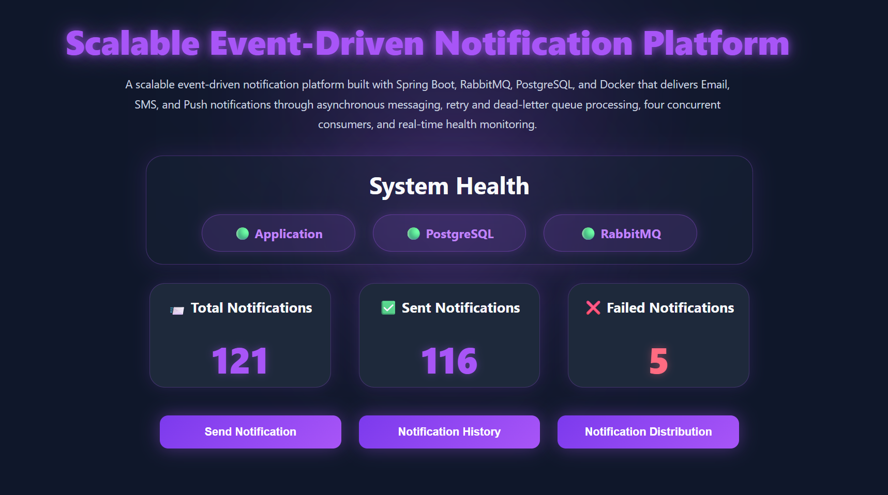
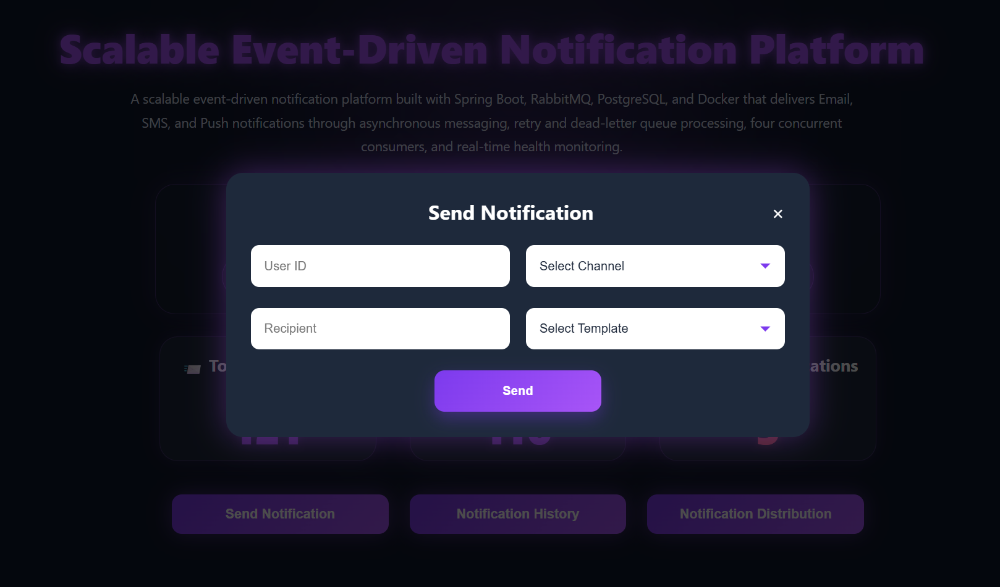
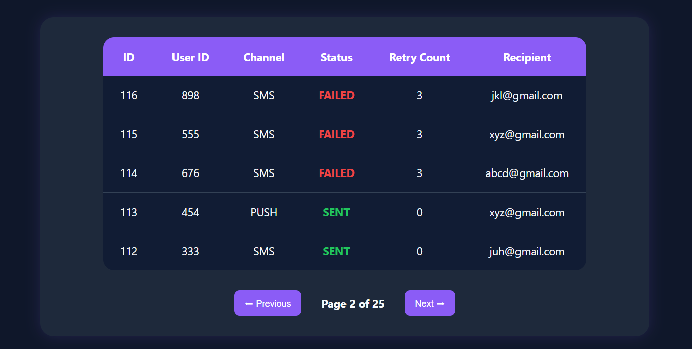
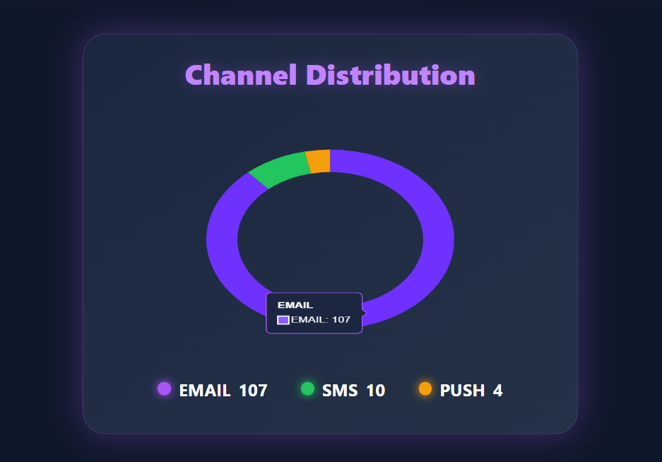
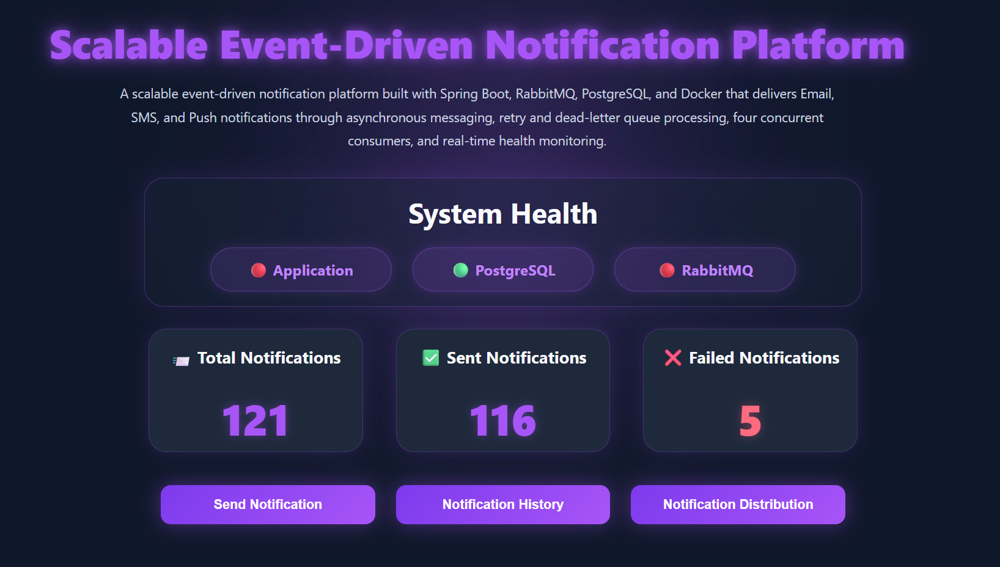

# 🚀 Scalable Event-Driven Notification System

A production-oriented Event-Driven Notification System built using Spring Boot, RabbitMQ, PostgreSQL, and Docker Compose that provides asynchronous notification processing, retry handling, dead-letter queue processing, concurrent consumers, health monitoring, and a real-time monitoring dashboard.

---

# 📖 Overview

This project demonstrates how modern distributed systems process notifications asynchronously while maintaining reliability, fault tolerance, and scalability.

The application follows a **Producer → RabbitMQ → Consumer** architecture where notification requests are published to RabbitMQ, processed asynchronously by consumers, and persisted in PostgreSQL.

The system includes retry handling, dead-letter queue processing, concurrent consumers, load testing, health monitoring, notification analytics, and a dashboard for real-time observability.

---

# 📸 Dashboard Preview

## ✅ Dashboard Overview



## ✉️ Send Notification



## 📜 Notification History



## 📊 Notification Distribution



## ⚠️ Failure Detection



---

# 📌 Features

✅ REST API for Notification Submission

✅ Asynchronous Notification Processing using RabbitMQ

✅ Email, SMS, and Push Notification Channels

✅ Retry Queue for Failed Messages

✅ Dead Letter Queue (DLQ) Handling

✅ Failure Recovery Mechanism

✅ Multiple Consumers for Concurrent Processing

✅ Load Testing and Consumer Scalability Validation

✅ Notification History Tracking with Pagination

✅ Real-Time Analytics Dashboard

✅ Application Health Monitoring

✅ PostgreSQL Health Monitoring

✅ RabbitMQ Health Monitoring

✅ Docker Compose Based Infrastructure Setup

---

# 🛠️ Tech Stack

## Backend

- Java 21
- Spring Boot
- Spring Data JPA
- Spring AMQP
- Spring Boot Actuator
- Lombok

## Database

- PostgreSQL

## Messaging

- RabbitMQ

## Frontend

- HTML
- CSS
- JavaScript
- Chart.js

## DevOps

- Docker
- Docker Compose

## Core Concepts

- Event-Driven Architecture
- Producer-Consumer Pattern
- Asynchronous Messaging
- Strategy Design Pattern
- Retry Queue Processing
- Dead Letter Queue (DLQ)
- Concurrent Consumer Processing
- Fault Tolerance
- Monitoring & Observability

---

# 🏗️ Architecture

```text
Notification Request
         |
         ▼
 ┌─────────────────┐
 │ REST API Layer  │
 └─────────────────┘
         |
         ▼
 ┌─────────────────┐
 │    Producer     │
 └─────────────────┘
         |
         ▼
 ┌─────────────────┐
 │    RabbitMQ     │
 └─────────────────┘
         |
         ▼
 ┌─────────────────┐
 │    Consumer     │
 └─────────────────┘
         |
         ▼
 ┌─────────────────┐
 │   PostgreSQL    │
 └─────────────────┘


 Failed Messages
         |
         ▼
 ┌─────────────────┐
 │   Retry Queue   │
 └─────────────────┘
         |
         ▼
 ┌─────────────────┐
 │ Dead Letter Q   │
 └─────────────────┘
```

---

# 📨 Notification Processing Flow

A notification request is submitted through the REST API.

### Example Request

```http
POST /notifications
```

```json
{
  "userId": "123",
  "recipient": "user@gmail.com",
  "channel": "EMAIL",
  "template": "WELCOME"
}
```

The Producer publishes the notification event to RabbitMQ.

Consumers process the message asynchronously and store processing results in PostgreSQL.

---

# 🔄 Retry Queue Processing

When notification processing fails:

```text
Consumer
   ↓
Retry Queue
```

The system automatically retries failed notifications before marking them as failed.

### Example

```text
Attempt 1 ❌
Attempt 2 ❌
Attempt 3 ❌
```

After reaching the retry limit, the message is moved to the Dead Letter Queue.

---

# ☠️ Dead Letter Queue (DLQ)

Messages that cannot be processed successfully after maximum retry attempts are routed to the Dead Letter Queue.

### Example

```text
Retry Count = 3
Status = FAILED
```

This prevents message loss while allowing failed messages to be inspected later.

---

# 👥 Multiple Consumer Processing

To improve throughput, the system uses multiple consumers.

### Example

```text
Consumer-1
Consumer-2
Consumer-3
Consumer-4
```

This enables concurrent message processing and better scalability under load.

---

# 📊 Monitoring Dashboard

The dashboard provides real-time visibility into:

- Total Notifications
- Sent Notifications
- Failed Notifications
- Notification History
- Notification Distribution by Channel
- Application Health
- PostgreSQL Health
- RabbitMQ Health

This helps monitor processing activity and identify failures quickly.

---

# ❤️ System Health Monitoring

### Healthy State

```text
🟢 Application
🟢 PostgreSQL
🟢 RabbitMQ
```

### Failure State

```text
🔴 Application
🟢 PostgreSQL
🔴 RabbitMQ
```

The dashboard automatically detects failures using Spring Boot Actuator health checks.

---

# ▶️ Running the Application

## Clone the Repository

```bash
git clone https://github.com/your-username/scalable-event-driven-notification-system.git
```

## Navigate to the Project

```bash
cd scalable-event-driven-notification-system
```

## Start Infrastructure

```bash
docker-compose up -d
```

## Run the Application

```bash
mvn spring-boot:run
```

## Access the Dashboard

```text
http://localhost:8080
```

---

# 🎯 Key Learnings

Through this project, I gained hands-on experience with:

- Event-Driven Architecture
- RabbitMQ Messaging
- Producer-Consumer Design Pattern
- Strategy Design Pattern
- Retry Queue Processing
- Dead Letter Queue Handling
- Failure Recovery Mechanisms
- Concurrent Consumer Processing
- Load Testing
- Spring Boot Actuator
- Real-Time Dashboard Development
- Docker Compose Infrastructure Setup
- Monitoring & Observability

---

# 🚀 Future Enhancements

- SMTP Email Integration
- Twilio SMS Integration
- Firebase Push Notifications
- Redis-Based Message Tracking
- Notification Scheduling
- User Preference Management
- Kubernetes Deployment
- Prometheus Integration
- Grafana Dashboards

---

# 👨‍💻 Author

**Jeevitha Rahiman**

*Passionate about Backend Development, Event-Driven Architecture, Distributed Systems, and building scalable Java applications.*

---

# 📄 License

This project is licensed under the MIT License.
